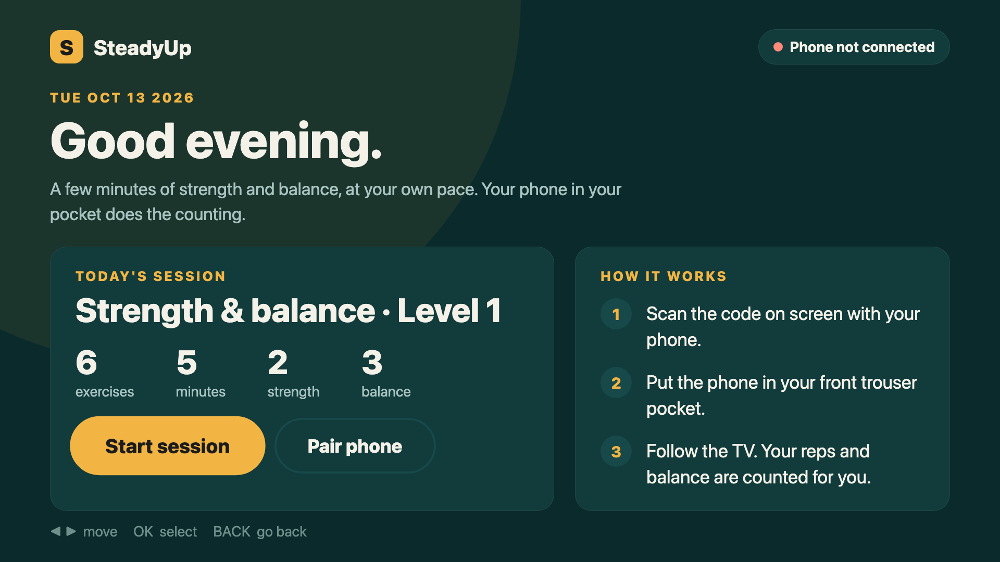
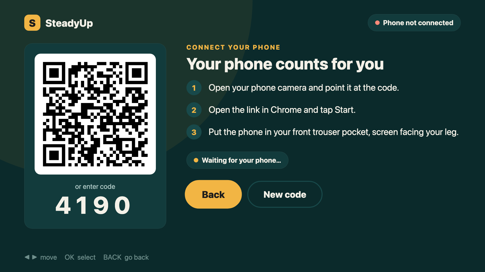
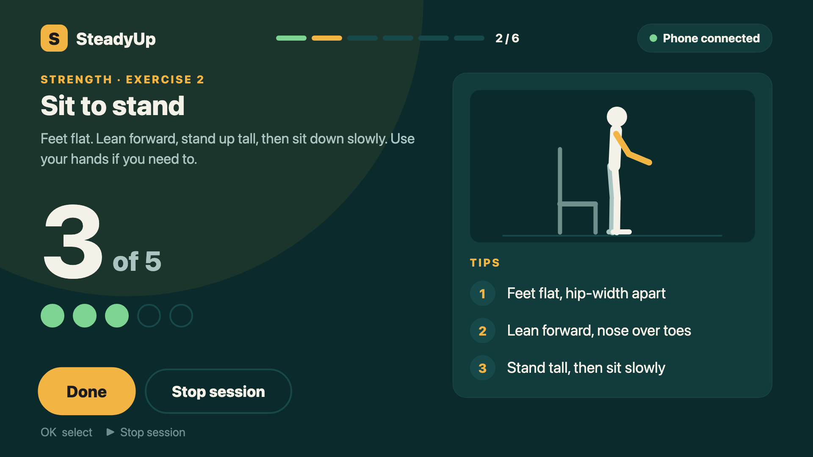
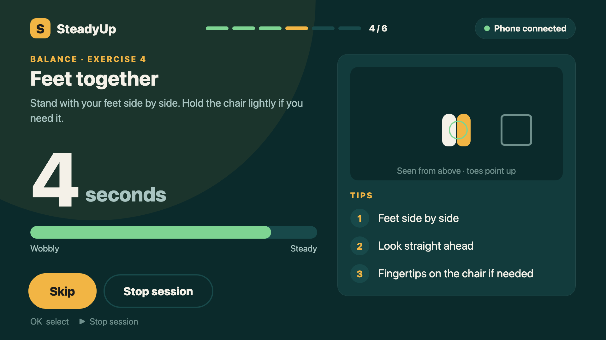
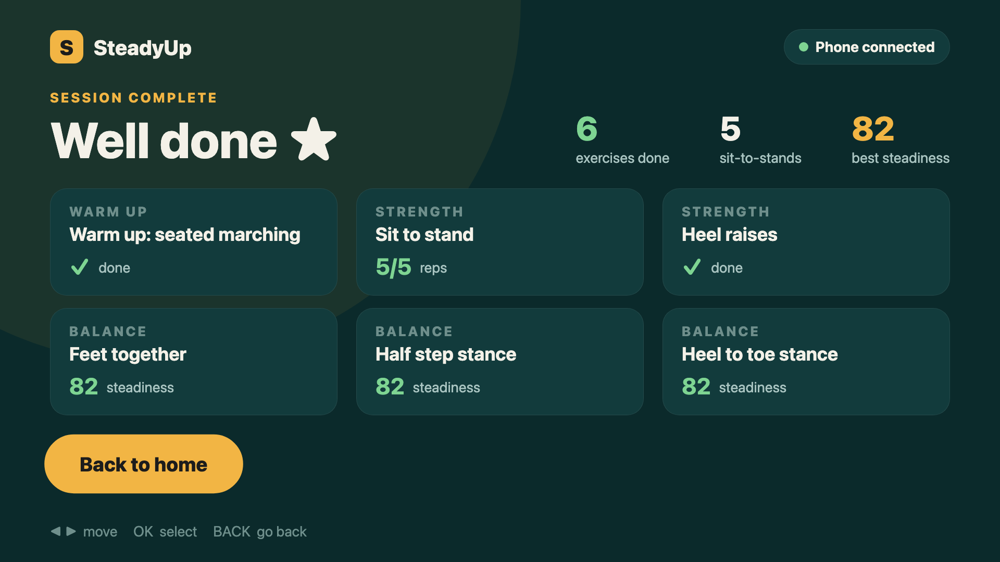

# SteadyUp

**Strength and balance exercises on your TV. The phone in your pocket does the counting.**

Falls are the leading cause of injury for older adults. Strength and balance
exercises cut the risk, but people stop doing them at home: nobody counts the
reps, nobody tells you whether you're getting steadier, and exercise apps on a
small phone screen are hard to follow.

SteadyUp turns the moves behind the CDC's STEADI fall-prevention tests (chair
stands and the feet together, semi-tandem and tandem balance stances, held for
10 seconds each) into a guided 5-minute routine on the TV, controlled with the remote.
The user scans a QR code with their phone and puts the phone in their front
trouser pocket. From then on:

- **sit-to-stands are counted automatically** from the angle of the thigh
- **balance holds get a live steadiness score** from how much the body sways
- **a sudden impact followed by stillness** triggers an "Are you OK?" prompt on the TV
- **a spoken coach** talks you through each move ("Stand up tall, then sit down
  slowly", rep counts, "Ten seconds left") through the phone's speaker, so
  nobody has to read the screen mid-exercise
- **an AI coach on Amazon Bedrock** writes a short personal message about
  today's results on the summary screen, and reads it aloud
- **progress and streaks** (day streak, sessions this week, steadiness trend)
  are kept **on the user's phone**: private, no account needed. A **Share my
  progress** button sends a summary to family through WhatsApp, SMS or email

There's no app to install on the phone and nothing to wear. It runs in the
phone's browser.

**Try it in your browser:** <https://steadyup.onrender.com/play>. The arrow keys
and Enter act as the TV remote; scan the QR code with your phone to pair. The
server is on a free plan, so the first visit can take about a minute to wake it.

**Demo video (on Fire TV, Vega OS virtual device):** https://youtu.be/3rN6LLTX-Eo



| Pair with a QR code | Reps counted from the pocket |
|---|---|
|  |  |
| **Live steadiness during balance holds** | **Session summary** |
|  |  |

## Today's session

| # | Exercise | How it is tracked |
|---|---|---|
| 1 | Warm up: seated marching | 30-second timer |
| 2 | Sit to stand | Reps counted by the phone (target 5) |
| 3 | Heel raises | Self-paced, user presses Done |
| 4 | Feet together | 10 s hold, steadiness score from the phone |
| 5 | Half-step stance | 10 s hold, steadiness score |
| 6 | Heel-to-toe stance | 10 s hold, steadiness score |

Before every session there's a short safety check (a chair within reach, a clear
floor, shoes on). Every exercise has an animated demo and three tips. The demos
are drawn with plain views rather than video files, so they work offline and
look the same on every TV platform.

## How it works

```
 ┌──────────────┐   WebSocket    ┌──────────────┐   WebSocket   ┌──────────────────┐
 │   TV app     │ ◄────────────► │  SteadyUp    │ ◄───────────► │ Phone browser    │
 │ (remote, UI) │  mode, results │  server      │  reps, sway,  │ (motion sensors, │
 └──────────────┘                │ pairing +    │  events       │  in the pocket)  │
                                 │ relay        │               └──────────────────┘
                                 └──────────────┘
```

1. The TV asks the server for a 4-digit session code and shows it with a QR code.
2. The phone opens `/p/<code>`, the user taps **Start** (granting motion access),
   and the phone joins the same session.
3. The TV tells the phone which mode to use (`reps`, `hold` or `idle`). The
   phone processes its motion sensors locally and sends back live state and
   events (`rep`, `hold_end`, `possible_fall`).

The motion processing is in [`server/public/motion.js`](server/public/motion.js)
and runs in the phone's browser:

- **Reps:** a low-pass filter estimates gravity. The angle between the current
  gravity vector and a "seated" reference taken at the start tells sitting
  (thigh horizontal) from standing (thigh vertical). A rep is counted on the
  return to sitting, with hysteresis (stand above 60°, seated below 30°) and a
  minimum rep time to reject jitter.
- **Steadiness:** the RMS spread of acceleration over the hold, ignoring the
  first 1.5 s while the person settles, mapped to a 0–100 score.
- **Possible fall:** an impact above 2.5 g followed by 2 s of stillness.

## AI coach (Amazon Bedrock)

When a session ends, the TV posts the results to `POST /api/coach`. The server
([`server/src/coach.js`](server/src/coach.js)) cleans the input, describes the
results in plain lines, and calls the **Amazon Bedrock Converse API** with
**Amazon Nova Lite** (`amazon.nova-lite-v1:0` in `ap-southeast-2`, set by `BEDROCK_MODEL_ID` and `AWS_REGION`).
The system prompt asks for two encouraging sentences: one specific win and one
practical tip, with no medical advice. The TV shows the reply in a "Your coach"
card and the phone reads it aloud.

The coach always answers: if Bedrock isn't configured, takes longer than 8
seconds, or fails, the server returns a rule-based message instead. Requests are
limited to 20 per client per 10 minutes.

To enable it, give an IAM user `bedrock:InvokeModel` permission, make sure
Amazon Nova Lite is available to the account in `ap-southeast-2` (Sydney), and set
`AWS_ACCESS_KEY_ID` and `AWS_SECRET_ACCESS_KEY` on the Render service (see
[`render.yaml`](render.yaml)).

## Repository layout

| Path | What it is |
|---|---|
| `server/` | Node.js pairing and relay server (HTTP and WebSocket), the phone page, and motion processing with unit tests |
| `tv/packages/shared-ui/src/steadyup/` | The SteadyUp TV screens, shared by every TV app |
| `tv/apps/expo-multi-tv/` | Android TV / Fire OS app from the template (not yet tested on a device), plus the web build used for testing and `/play` |
| `tv/apps/vega/` | Fire TV app for Vega OS |
| `scripts/dev-tunnel.sh` | Starts the server behind a public HTTPS tunnel and points the TV app at it |
| `scripts/e2e-tv.mjs` | End-to-end test: drives the TV app in headless Chrome with a simulated phone |
| `scripts/make-video.mjs` | Builds the demo video from a recorded test run |
| `scripts/build-web-app.sh` | Builds the TV app for the browser into `server/public/app/`, served at `/app/` and `/play` |

The TV app is built on Amazon's
[react-native-multi-tv-app-sample](https://github.com/AmazonAppDev/react-native-multi-tv-app-sample)
template (MIT-0), which provides the multi-platform setup and remote-control
focus handling. The SteadyUp screens, server, phone page and motion processing
were written for this project.

## Running it

Requirements: Node 20+ and Yarn (for `tv/`). Phones only allow motion sensors
on HTTPS pages, so the server must be reachable over HTTPS.

**1. Server**

The server is deployed on Render at **https://steadyup.onrender.com** from
[`render.yaml`](render.yaml), and the TV app points there
(`tv/packages/shared-ui/src/steadyup/config.ts`). On the free tier it sleeps
when idle; the first request wakes it in about a minute.

To work on the server locally, use a temporary HTTPS tunnel
([cloudflared](https://developers.cloudflare.com/cloudflare-one/connections/connect-networks/downloads/)):

```bash
cd server && npm install && cd ..
scripts/dev-tunnel.sh
```

This prints a `https://….trycloudflare.com` URL and writes it into `config.ts`.
Rebuild the TV app after it changes, and set it back to the Render URL before
building for a demo.

**2. TV app**

```bash
cd tv && yarn install
yarn dev:web                       # in a browser: arrow keys + Enter act as the remote
yarn dev:android                   # Android TV / Fire TV (Fire OS) over adb
yarn build:vega                    # Fire TV (Vega OS): builds .vpkg files in tv/apps/vega/build/
```

To install on a Vega OS Fire TV, turn on Developer Mode on the device, then
`vega run-app tv/apps/vega/build/armv7-release/vega_armv7.vpkg`.

**3. Phone**

On the TV, choose **Pair phone** and scan the QR code. Open the link in Chrome
(Android) or Safari (iPhone), tap **Start**, and put the phone in your front
trouser pocket, screen facing your leg.

## Tests

```bash
cd server && npm test              # 30 tests: pairing, relay, rep counting, steadiness, fall detection, AI coach, history
```

End-to-end, with the TV web build served on port 8090, against the live server:

```bash
node scripts/e2e-tv.mjs http://localhost:8090 https://steadyup.onrender.com out/e2e /tmp/chrome-profile
```

The test pairs a simulated phone, runs the whole session, saves a screenshot of
every screen to `out/e2e/`, prints every spoken coaching cue the phone receives,
and fails if content on any screen overlaps the footer or runs off a 1920×1080 TV.

To record the demo video, set `E2E_RECORD=<frames-dir>` and then run
`node scripts/make-video.mjs <frames-dir> out/steadyup-demo.mp4`.

## Safety note

SteadyUp is not a medical device. It encourages exercise and gives feedback; it
doesn't diagnose anything, and its fall prompt doesn't replace an emergency
alarm. The exercises are based on the moves in the CDC's STEADI tests, but
SteadyUp is not a clinical assessment.

## License

MIT. See [LICENSE](LICENSE). The TV app template it is built on is MIT-0.
